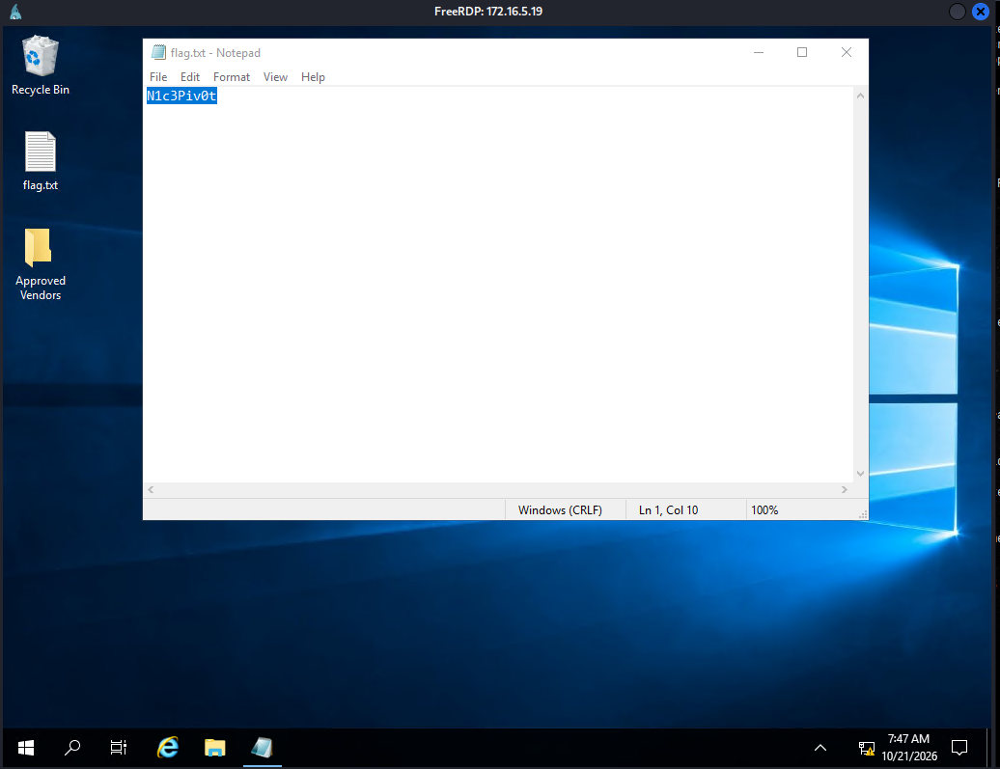

## Port Forwarding

- Port Forwarding is a technique that allows us to redirect a communication request from one port to another. 
- Port forwarding uses TCP as primary means of communication to provide interactive communication for the forwarded port.


#### Example Scenario


- Here the Victim Server's MYSQL database is not accessible from outside network. Like the one from the Attack Host.
- The SSH service of the Victim Server accepts connection from any devices outside at port 22. 
- The Attack Host communicates with the SSH server and tells it to redirect the data sent to 22 at port 3306.
- The SSH service redirects the data sent to port 22 to port 3306 and the SQL database executes it. Since the data is sent locally so it bypasses the firewall and the firewall doesn't block the incoming data packets.
- The Attack Host can sent malicious commands and perform port forwarding to redirect the data sent to port 22 to port 3306 because of this and then execute that payload on the Victim Server's MYSQL database.


## Proxy

- An intermediary computer or software that sits between your device and the internet. 
- It forwards your web requests, hides your real IP address from websites, and can filter, cache, or control data flow.

## SOCKS

- A network protocol that routes internet traffic between client and server through a proxy server.
- Your connection requests doesn't go directly to the destination, rather via the SOCKS server.
- The SOCKS is a low level general purpose proxy that handles any type of network protocol(**TCP/UDP/FTP/SMTP ...etc..**.) without inspecting the payload.


---
## Questions and Solutions


- You have successfully captured credentials to an external facing Web Server. Connect to the target and list the network interfaces. How many network interfaces does the target web server have? (Including the loopback interface)
	- **3**

`SSH to 10.129.246.41 (ACADEMY-PIVOTING-LINUXPIV), with user "ubuntu" and password "HTB_@cademy_stdnt!"`

#### SSH into the target server

```bash
❯ target=10.129.246.41
❯ target
zsh: command not found: target
❯ echo $target
10.129.246.41
❯ ssh ubuntu@$target
The authenticity of host '10.129.246.41 (10.129.246.41)' can't be established.
ED25519 key fingerprint is: SHA256:AtNYHXCA7dVpi58LB+uuPe9xvc2lJwA6y7q82kZoBNM
This key is not known by any other names.
Are you sure you want to continue connecting (yes/no/[fingerprint])? yes
...(SNIP)...
ubuntu@WEB01:~$ ifconfig
ens192: flags=4163<UP,BROADCAST,RUNNING,MULTICAST>  mtu 1500
        inet 10.129.246.41  netmask 255.255.0.0  broadcast 10.129.255.255
        inet6 fe80::250:56ff:fe8a:ea86  prefixlen 64  scopeid 0x20<link>
        inet6 dead:beef::250:56ff:fe8a:ea86  prefixlen 64  scopeid 0x0<global>
        ether 00:50:56:8a:ea:86  txqueuelen 1000  (Ethernet)
        RX packets 3708  bytes 285303 (285.3 KB)
        RX errors 0  dropped 0  overruns 0  frame 0
        TX packets 625  bytes 50460 (50.4 KB)
        TX errors 0  dropped 0 overruns 0  carrier 0  collisions 0

ens224: flags=4163<UP,BROADCAST,RUNNING,MULTICAST>  mtu 1500
        inet 172.16.5.129  netmask 255.255.254.0  broadcast 172.16.5.255
        inet6 fe80::250:56ff:fe8a:db95  prefixlen 64  scopeid 0x20<link>
        ether 00:50:56:8a:db:95  txqueuelen 1000  (Ethernet)
        RX packets 149  bytes 11931 (11.9 KB)
        RX errors 0  dropped 16  overruns 0  frame 0
        TX packets 130  bytes 9670 (9.6 KB)
        TX errors 0  dropped 0 overruns 0  carrier 0  collisions 0

lo: flags=73<UP,LOOPBACK,RUNNING>  mtu 65536
        inet 127.0.0.1  netmask 255.0.0.0
        inet6 ::1  prefixlen 128  scopeid 0x10<host>
        loop  txqueuelen 1000  (Local Loopback)
        RX packets 1537  bytes 121148 (121.1 KB)
        RX errors 0  dropped 0  overruns 0  frame 0
        TX packets 1537  bytes 121148 (121.1 KB)
        TX errors 0  dropped 0 overruns 0  carrier 0  collisions 0
```


- Apply the concepts taught in this section to pivot to the internal network and use RDP (credentials: victor:pass@123) to take control of the Windows target on 172.16.5.19. Submit the contents of Flag.txt located on the Desktop.


After trying to login using the RDP credentials from the Attack Machine directly we failed so we are going to use the SSH machine as our pivot machine. So first we are going to setup the **DYNAMIC PORT FORWARDING**.

#### Setting Up Dynamic Port Forwarding

- This pivot machine we are going to use as a relay server by sending commands from our attack machine and then the pivot machine is going to route or redirect these commands to the RDP machine. Since the SSH machine and RDP machine are on the same internal IP network so we the RDP machine won't block its packets or drop it.

```bash
ssh -D 9050 ubuntu@$target
```

#### `RDP` into target machine Using Proxychains

- Before sending the data directly to `victor`, `proxychains` encapsulates the entire data or command and sends it to the `ubuntu` user via the SOCKS protocol and upon receiving the `ubuntu` user redirects that command to the `victor` user. This time `victor` user doesn't drop it because `ubuntu` is part of the internal IP and it trusts it.

```bash
❯ proxychains xfreerdp3 /v:172.16.5.19 /u:victor /p:'pass@123'
```



